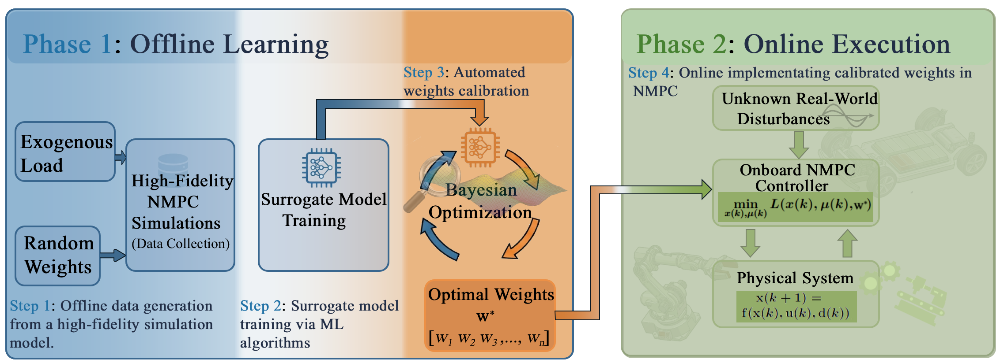
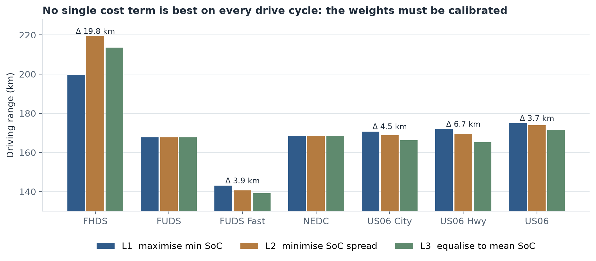
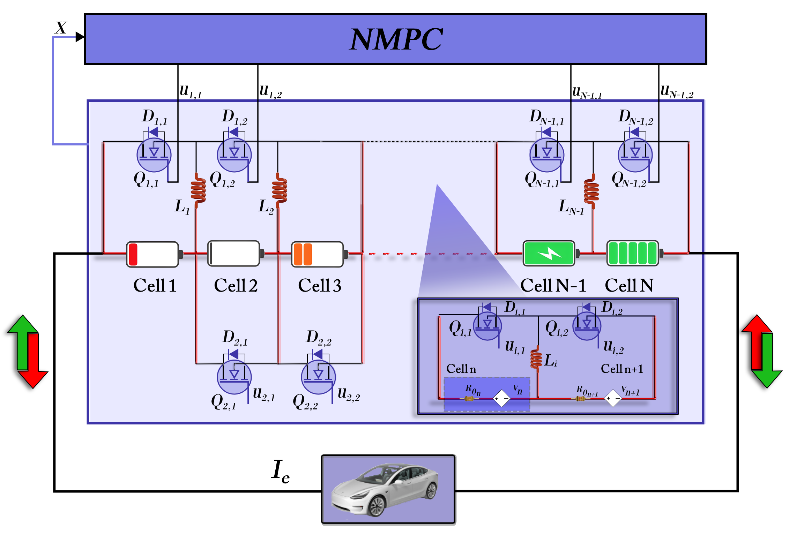
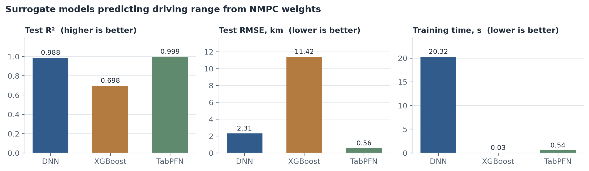
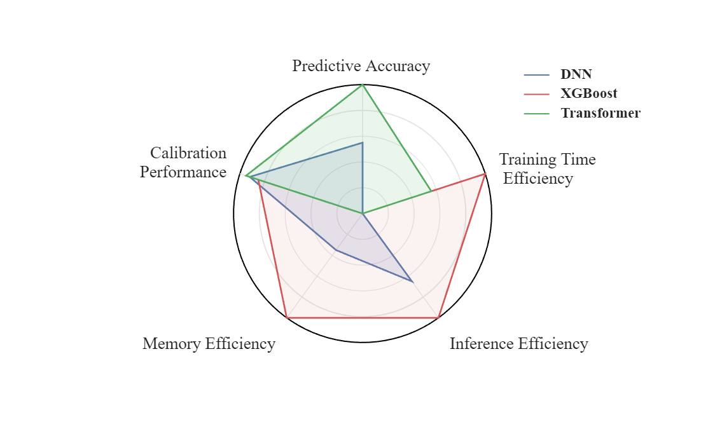
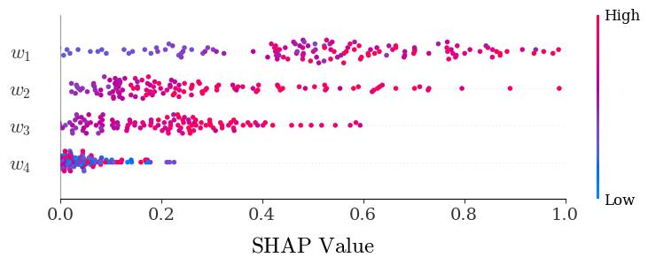
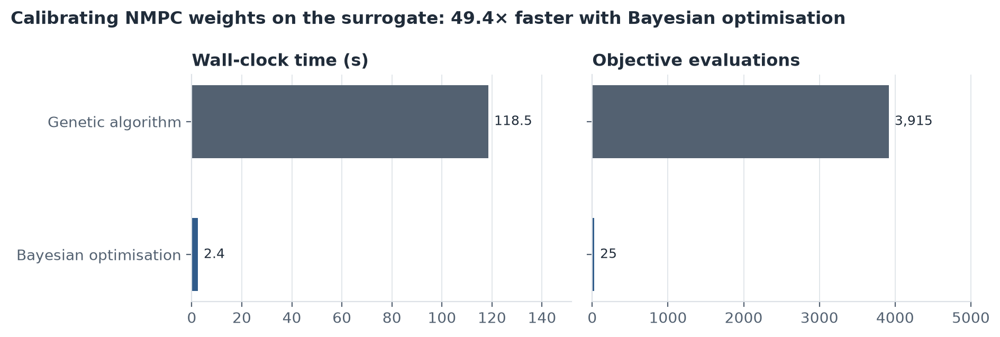
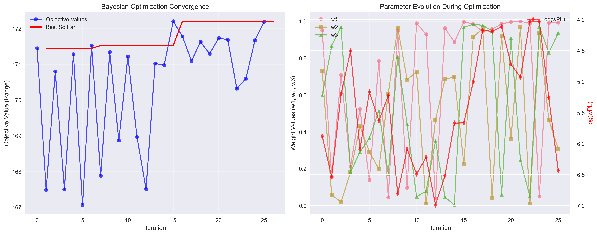

<div align="center">

# ML-Based Active Cell Balancing for EV Range Extension

**Fast calibration of a nonlinear model predictive controller (NMPC) with machine-learned surrogates and Bayesian optimisation.**

Final-year project · B.S. Electrical (Computer) Engineering · COMSATS University Islamabad · Aug 2024 – May 2025

[](https://danishzulfiqar-projects.vercel.app/ev-cell-balancing)
[](https://doi.org/10.2139/ssrn.7192447)


</div>

<table align="center">
<tr>
<td align="center"><h2>49.4×</h2>faster weight calibration<br><sub>Bayesian optimisation vs genetic algorithm<br>on the surrogate (2.40 s vs 118.5 s)</sub></td>
<td align="center"><h2>+4 km</h2>average driving range<br><sub>calibrated vs non-calibrated NMPC</sub></td>
<td align="center"><h2>R² 0.999</h2>surrogate accuracy<br><sub>TabPFN, test RMSE 0.56 km</sub></td>
</tr>
</table>

> 📘 **Full write-up with figures:** [danishzulfiqar-projects.vercel.app/ev-cell-balancing](https://danishzulfiqar-projects.vercel.app/ev-cell-balancing)

## Overview

In a series-connected lithium-ion pack, the **weakest cell limits the whole pack**: once it reaches its lower state-of-charge (SoC) limit the vehicle has to stop, even though the other cells still hold energy. *Active cell balancing* moves charge between neighbouring cells through inductive DC–DC converters to keep the cells even, and an **NMPC** decides at every step how hard to drive each converter.

The NMPC balances several competing goals: lift the weakest cell, shrink the SoC spread, keep cells close to the mean, and avoid wasting energy in the converters. These goals are traded off through **cost-function weights**. The weights have a large effect on driving range, but each candidate set can only be scored by running a full closed-loop drive-cycle simulation. That makes hand tuning slow and black-box optimisation expensive.

This project replaces those simulations with a **learned surrogate model** of *weights → driving range*, then searches the surrogate with **Bayesian optimisation**. The calibrated weights are deployed back into the NMPC.

<p align="center"></p>

## Why the weights need calibration

Running the NMPC with only one objective switched on shows that **the best objective depends on the drive cycle**. On FHDS the choice of term changes range by almost 20 km, while on US06 Highway the best term is a different one. No fixed choice wins everywhere, so the weights have to be tuned for the conditions.

<p align="center"></p>

## System and controller

<p align="center"></p>

The plant is a **three-cell series pack** (3 Ah cells, 8th-order OCV–SoC polynomial, 25 mΩ internal resistance) with two bidirectional inductor-based balancing converters (6 µH, 50 kHz switching). Conduction, switching, reverse-recovery and dead-time losses are all modelled. The NMPC, implemented in **CasADi** and solved with **IPOPT** inside a Simulink System object ([`Range_Max_2.m`](Range_Max_2.m)), uses:

| | |
|---|---|
| States | cell SoCs $x_1, x_2, x_3 \in [0.05,\,0.95]$ |
| Inputs | four converter duty cycles $u_{11}, u_{12}, u_{21}, u_{22} \in [t_d/T_s,\,0.4]$ |
| Horizon | $N = 5$ steps, $\Delta t = 5$ s (25 s look-ahead), explicit Euler discretisation |
| Disturbance | pack current $I_s$ from the drive cycle |

The stage cost combines four objectives, with smooth log-sum-exp approximations of max and min SoC:

$$
\ell(x,u) \;=\; w_1\underbrace{\left(-\min_i x_i\right)^2}_{L_1:\ \text{lift weakest cell}}
\;+\; w_2\underbrace{\left(\max_i x_i-\min_i x_i\right)^2}_{L_2:\ \text{shrink spread}}
\;+\; w_3\underbrace{\sum_i \left(x_i-\bar{x}\right)^2}_{L_3:\ \text{track the mean}}
\;+\; w_4\underbrace{P_\text{loss}(x,u)}_{\text{converter losses}}
\;+\; f_u^2
$$

The calibration problem is to find

$$
\mathbf{w}^\star=\arg\max_{\mathbf{w}}\ \text{Range}\big(\text{NMPC}(\mathbf{w}),\ \text{drive cycle}\big),
\qquad w_{1,2,3}\in[0,1],\ \ w_4\in[0,10^{-4}].
$$

## Method

1. **Simulate.** [`Sim_Run_Auto.m`](Sim_Run_Auto.m) runs closed-loop Simulink simulations in batches, randomising the initial SoC of each cell (0.50–0.90) and the four weights, and cycles through the standard drive cycles (FUDS, FUDS Fast, US06 City, US06 Highway and others). The range reached in each run is recorded.
2. **Learn the surrogate.** Three regressors map *(weights, drive cycle) → range*: a deep neural network (TensorFlow), **XGBoost** and **TabPFN**, a pretrained tabular transformer.
3. **Calibrate.** **Bayesian optimisation** searches the surrogate for the range-maximising weights. Genetic-algorithm, particle-swarm, simulated-annealing and random-search wrappers serve as baselines.
4. **Validate.** The calibrated weights are run in the full NMPC-in-the-loop simulation and compared with non-calibrated settings.
5. **Explain.** SHAP and LIME quantify how each weight drives range.

## Results

### Surrogate models

<p align="center"></p>

**TabPFN** is the most accurate surrogate (R² = 0.999, RMSE = 0.56 km). **XGBoost** trains and predicts fastest but is the least accurate. The DNN sits in between. Despite these accuracy differences, **closed-loop calibration results were comparable across all three model classes**, so the choice can follow the deployment budget.

<table>
<tr>
<td width="50%"></td>
<td width="50%"><br><sub><b>SHAP analysis.</b> w₁ (lifting the weakest cell) has the strongest influence on range, followed by w₂ and w₃. The loss weight w₄ matters least at its physical scale.</sub></td>
</tr>
</table>

### Calibration speed

<p align="center"></p>

Bayesian optimisation reaches the optimum in **25 evaluations instead of 3,915**, a **49.4× reduction in wall-clock time**. The calibrated NMPC extends driving range by **4 km on average** over the non-calibrated controller.

<details>
<summary><b>Bayesian optimisation trace on the XGBoost surrogate</b></summary>
<p align="center"></p>
</details>

## Repository structure

```
├── Range_Max_2.m                 # CasADi NMPC as a Simulink System object
├── Range_ext_TCST_NoSDKF.slx     # Simulink plant: 3-cell pack + balancing converters + NMPC
├── Sim_Run.m · Sim_Run_Auto.m    # single run / automated randomised data generation
├── charging_current.m · discharging_current.m · power_losses.m
├── test_optimal_weights.m        # replay calibrated weights per drive cycle
├── comparison_test_weights.m     # compare weight sets across drive cycles
├── CurrentVelocityData/          # drive-cycle current profiles (.mat)
├── GA_Wrapper/ · PSO_Wrapper/ · SA_Wrapper/ · RS_Wrapper/ · Parallel_GA_Wrapper/
│                                 # simulation-in-the-loop optimisation baselines
├── Realtime/                     # online optimisation experiments
├── MiskCodes/Analysis/Python/    # surrogate modelling and Bayesian optimisation
│   ├── Python Main Container/    #   DNN notebooks, datasets, MPC comparison (EAAI_Codes/)
│   ├── .../XG_BOOST/             #   XGBoost surrogate + Bayesian optimisation
│   └── .../Transformer/          #   TabPFN surrogate
├── scripts/plot_results.py       # README figures
└── assets/                       # figures
```

## Getting started

**Requirements:** MATLAB with Simulink and the Optimization and Global Optimization toolboxes, plus [CasADi for MATLAB](https://web.casadi.org/get/) on the MATLAB path. The Python notebooks need Python 3.10 with TensorFlow, XGBoost, TabPFN, scikit-learn, `bayesian-optimization` and SHAP.

```matlab
% 1. Single closed-loop simulation with chosen weights
Sim_Run

% 2. Generate a randomised training dataset (writes GeneratedData/*.mat)
Sim_Run_Auto

% 3. Evaluate calibrated weights on each drive cycle
test_optimal_weights
```

Surrogate training and Bayesian optimisation live in the notebooks under `MiskCodes/Analysis/Python/`. To regenerate the README figures, run `python scripts/plot_results.py`.

## Publication

> D. Zulfiqar, A. Ahmed, A. Arshad and Q. Ahmed, **"Machine Learning-Based Framework for Fast Calibration of Non-Linear Model Predictive Control,"** under review at *Engineering Applications of Artificial Intelligence*, 2026. Preprint: [SSRN 7192447](https://doi.org/10.2139/ssrn.7192447).

```bibtex
@article{zulfiqar2026mlnmpc,
  title   = {Machine Learning-Based Framework for Fast Calibration of Non-Linear Model Predictive Control},
  author  = {Zulfiqar, Danish and Ahmed, A. and Arshad, A. and Ahmed, Q.},
  journal = {SSRN preprint 7192447},
  year    = {2026},
  doi     = {10.2139/ssrn.7192447}
}
```

## Author

**Danish Zulfiqar**. [danishzulfiqar.com](https://danishzulfiqar.com) · [GitHub](https://github.com/danishzulfiqar)
